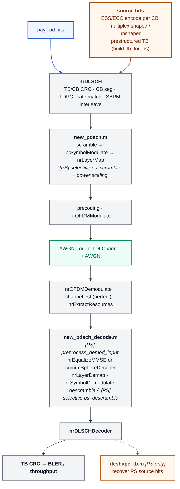

# evaluation-link-simulator

MATLAB based link-level simulator for fixed-MCS BLER and throughput studies, comparing a standard 5G NR uniform-QAM chain against probabilistic-shaping (PS) chains built around ESS (Enumerative Sphere Shaping) or ECC (polar-code cover-code shaping).

## Supported Features

- Fixed-MCS DL PDSCH BLER and throughput versus SNR, for both AWGN and TDL/CDL fading channels.
- 5G NR uniform-QAM transmit/receive chain using MATLAB 5G Toolbox primitives (`nrDLSCH`, `nrPDSCH*`, `nrOFDMModulate`, `nrDLSCHDecoder`).
- Two probabilistic-shaping (PS) codecs, selected via `cfg.shaping.mode`, sharing the same TX/RX pipeline hooks:
  - ESS-based shaping
  - ECC-based (multi-level polar cover-code) shaping. See [ECC-Based Shaping](#ecc-based-shaping).
- IR-HARQ based retransmission and combining: up to `cfg.simulation.maxNumTransmissions` attempts per TB with a configurable RV sequence and early exit on CRC success. See [HARQ / Retransmission Support](#harq--retransmission-support).
- PS MCS tables (`ps_mcs_table1`, `ps_mcs_table2`, `ps_mcs_table3`), plus uniform tables `qam64`/`qam256`/`qam1024`/`qam_nrminus1`. See [Uniform MCS Tables](#uniform-mcs-tables).
- Adaptive modulation and coding (AMC) (`cfg.simulation.amc.enabled`): selection between two MCS tables, based on the measured per-layer effective-SNR spread. See [AMC](#amc).
- TBS matching bewteen uniform QAM and PS: for PS mode, for each MCS with the coding rate determined from the MCS table, compute the MB parameter `nu` so PS payload TBS matches the uniform-QAM TBS for the same MCS (`shaping.matchUniformTbs`).
- Supported channel models
  - TDL-A/B/C/D/E fading channel through `nrTDLChannel`, including NTN-TDL-A/B/C/D profiles to simulate NTN scenarios (requires MATLAB R2024a+)
  - CDL-A/B/C/D/E fading channel through `nrCDLChannel`, with configurable antenna arrays and analog beamforming
  - AWGN channel mode with 1Tx 1Rx 1layer
  - Uplink direction support for CDL via `cfg.channel.swapTransmitAndReceive` (swaps Tx/Rx antenna arrays and angles)
- Supported demodulation methods
  - MMSE equalization through `nrEqualizeMMSE`
  - Sphere detection through `comm.SphereDecoder` (`receiver.demapper = "sphere"`)
  - An open-source fast-sphere decoder (`receiver.demapper = "fast_sphere"`) that is algorithmically faster per detection. See [Fast-Sphere Decoder](#fast-sphere-decoder) for instructions.
- Precoding methods
  - Open-loop precoding for configurable Tx/Rx/layer counts with `dft`, `identity`, or `hadamard` precoder options,
  - SVD-based closed-loop precoding (`mimo.precodingMode = "closedloop"`) based on periodic SRS  with configurable subband size, SRS periodicity and feedback delay; See [Closed-Loop Beamforming](#closed-loop-beamforming).
- Single-codeword operation, up to 4 PDSCH layers.
- Rank adaptation: select the proper (rank, MCS) combination for a given channel model

## Requirements

- MATLAB R2023a or newer (for 1024QAM support).
- For ECC based shaping, MATLAB R2024a and newer are required.
- MATLAB 5G Toolbox.
- Communications Toolbox is required for the sphere-decoder receiver path (`comm.SphereDecoder`).

## Matlab trial license

Here is a URL for 3GPP members to request a Matlab trial license (including the required toolbox license) to use this simulator.

https://content.mathworks.com/viewer/95cd5382c678ed6708870b99acdc6583

## Installation Instructions

1. Clone the repository (in a terminal / Git Bash):

   ```bash
   git clone git@github.com:qualcomm/evaluation-link-simulator.git
   cd evaluation-link-simulator
   ```

   Or over HTTPS:

   ```bash
   git clone https://github.com/qualcomm/evaluation-link-simulator.git
   cd evaluation-link-simulator
   ```
2. Launch MATLAB and change to the repository root, e.g.:

   ```matlab
   cd 'C:\path\to\evaluation-link-simulator'
   ```
3. Add the repository root to the MATLAB path so the `+toolbox` package is visible:

   ```matlab
   addpath(pwd)
   ```

   The `+toolbox`, `+config`, `+phy`, and `+ProbShaping` packages are resolved automatically from the root — do **not** `addpath(genpath(pwd))` the package (`+`) folders.
4. Verify the setup by running a driver script from the repository root:

   ```matlab
   run_scenario("scenario_awgn")
   ```

   A results folder should appear under `results/`. If MATLAB reports an undefined `toolbox.runSimulation`, the repository root is not on the path — re-run step 3.

## Active Entry Points

Each scenario is a pure-parameter `tests/scenarios/scenario_*.m` function, run through the single shared driver `tests/run_scenario.m`, which loads it via the common `toolbox.loadScenario` → `toolbox.launchScenario` → `toolbox.post.plot_scenario` pipeline:

- `tests/scenarios/scenario_awgn.m`: interactive AWGN fixed-MCS sweep, three-way comparison of uniform QAM, ESS-shaped, and ECC-shaped PS chains. Edit the `USER SETTINGS` block at the top of the scenario file.
- `tests/scenarios/scenario_mimo.m`: interactive TDL/open-loop MIMO sweep driver (uniform and/or PS chain modes).
- `tests/scenarios/scenario_simo.m`: interactive TDL SIMO sweep driver (1 Tx, many Rx, single layer; uniform and/or PS chain modes).
- `tests/scenarios/scenario_awgn_harq.m`: AWGN fixed-MCS evaluation with IR-HARQ.
- `tests/scenarios/scenario_amc.m`: CDL-A 32x4 closed-loop AMC comparison (uniform baseline vs. uniform AMC vs. PS AMC). See [AMC](#amc).
- `tests/scenarios/scenario_mimo_uniform_amc.m`: TDL-A open-loop 4x4 rank-4 BLER comparison of `qam256`, `qam1024`, and `qam_nrminus1` at a fixed MCS (uniform QAM only). See [Uniform MCS Tables](#uniform-mcs-tables).
- `tests/scenarios/3GPP_eval_scenarios/`: 3GPP-evaluation reproduction scenarios (CDL MIMO with closed-loop precoding at 32x4/4x4 for CDL-A/B/C, an NTN-TDL-C open-loop link, and a CDL 1Tx32Rx uplink SIMO link). See [Source Layout](#source-layout).
- `tests/run_scenario.m`: shared driver — `run_scenario(scenario_file)` loads, launches, and postprocesses the named scenario (e.g. `run_scenario("scenario_mimo_cdl_a_32x4")`), resolving scenario functions from `tests/scenarios/` and its subfolders.
- `toolbox.loadScenario(params, repo_root)`: expands a scenario's `params` struct into ready-to-run configs (`scenario.variants`).
- `toolbox.launchScenario(scenario)`: runs every variant via `toolbox.runSimulation`, annotates and aggregates the summary rows, and writes CSV/`.mat` output.
- `toolbox.post.plot_scenario(run_result)`: postprocesses a launched scenario into BLER/throughput-vs-SNR overlay figures (and, where applicable, the PS-vs-uniform SNR gain).
- `toolbox.runSimulation(cfg)`: programmatic single-simulation API, used by `toolbox.launchScenario` under the hood.

Run any scenario from MATLAB in the repository root by name:

```matlab
run_scenario("scenario_awgn")
run_scenario("scenario_mimo")
run_scenario("scenario_simo")
run_scenario("scenario_awgn_harq")
run_scenario("scenario_amc")
run_scenario("scenario_mimo_cdl_a_32x4")
run_scenario("scenario_ntn")
run_scenario("scenario_simo_cdl_1x32_ul")
```

Each run writes outputs to a timestamped folder under `results/`:

- a `*_summary.csv` table with per-SNR BLER, throughput, chain mode, MCS, MCS table, TBS, and shaping metadata.
- a `*_workspace.mat` with the summary table, all `results` structs, and the base config.
- a `*_summary.fig`/`.png` overlay figure with BLER (log-scale) and throughput subplots.

For programmatic use:

```matlab
cfg = toolbox.defaultConfig(struct('shaping', struct('enabled', true)));
results = toolbox.runSimulation(cfg);
disp(results.summaryTable)
```

## Main Parameters

Edit only the `USER SETTINGS` block in `tests/scenarios/scenario_awgn.m` / `scenario_mimo.m` / `scenario_simo.m` for normal runs. Settings common to all three scenarios (shown with representative defaults; see each scenario file for the full list):

```matlab
chain_modes = ["uniform", "ess", "ecc"];   % "uniform", "ps", or both
mcs_list = 20;                     % fixed-MCS points to sweep
snr_db = 16:0.5:20;                % SNR sweep grid, dB
num_transport_blocks = 100;        % TBs per SNR point
rng_seed = 42;                     % RNG seed for repeatable runs

num_tx_antennas = 1;
num_rx_antennas = 1;
num_pdsch_layers = 1;
prb_set = 0:7;                     % allocated PRBs
pdsch_symbol_allocation = [0 9];   % [startSymbol numSymbols]

uniform_mcs_table = "qam256";      % "qam64" or "qam256"
ps_mcs_table = "ps_mcs_table1";    % "ps_mcs_table1" or "ps_mcs_table2"
num_shaped_bit_level = 2;          % shaped amplitude bit levels per dimension
ps_tx_scaling = "lut";             % "empirical" or "lut"
match_ps_tbs_to_uniform = true;    % bisect ESS nu to match uniform TBS

receiver_demapper = "mmse";        % "mmse" or "sphere"
max_ldpc_iterations = 25;          % LDPC decoder iteration cap
ldpc_decoding_algorithm = "Layered belief propagation";
make_plots = true;                 % save overlay BLER/throughput figures
output_root = "results/awgn";      % output directory root
```

Per-scenario differences:

- `tests/scenarios/scenario_awgn.m`: AWGN channel, single antenna (defaults `1x1`, 1 layer). No channel/precoding settings — the base config hardcodes the AWGN model. `chain_modes` defaults to `["uniform", "ess", "ecc"]` (the other two scenarios default to `["uniform", "ps"]`, where `"ps"` means ESS).
- `tests/scenarios/scenario_mimo.m`: TDL fading (hardcoded `channel.model = "tdl"`, `TDL-A` profile) with open-loop precoding (defaults `4x4`, 4 layers). Adds `tdl_delay_spread`, `maximum_doppler_hz`, and `open_loop_precoder` (`"dft"`, `"identity"`, `"hadamard"`); `output_root = "results/mimo"`.
- `tests/scenarios/scenario_simo.m`: TDL fading (hardcoded `channel.model = "tdl"`, `TDL-A` profile), 1 Tx / many Rx / single layer with the identity open-loop precoder. Adds `tdl_delay_spread`, `maximum_doppler_hz`, and `open_loop_precoder`; `output_root = "results/mimo"`.

## TX Chain

Shared NR path (both chain modes):

```text
payload bits
-> nrDLSCH (TB/CB CRC, CB segmentation, LDPC, rate matching, SBPM interleaving)
-> new_pdsch.m: scramble/descramble for unform QAM. shared nrSymbolModulate, nrLayerMap
-> Precoding (both open-loop and closed-loop)
-> nrOFDMModulate
-> AWGN or nrTDLChannel + AWGN
```

PS adds, ahead of the shared path:

```text
source bits
-> prestructured transport block (build_tb_for_ps.m)
-> ESS/ECC encode (per code block, +toolbox/+ProbShaping/+ess (/+ecc))
-> multiplexing of shaped and unshaped bits
```

and inside `new_pdsch.m`: selective scrambling of shaped bits (`ps_scramble.m`) and PS power normalization (`empirical` measures per-TB symbol energy; `lut` uses a precomputed table via `getTxScaling.m`).

## RX Chain

Shared NR path (annotated with owner boundaries; `[PS]` marks PS-only steps, `[PS*]` marks steps that behave differently under PS):

```text
nrOFDMDemodulate                              ┐ upstream (runSimulation.m, shared)
-> channel estimation (perfect)               │
-> nrExtractResources                         ┘
── new_pdsch_decode.m ──────────────────────────────────────────────────────
-> [PS] preprocess_demod_input.m (Cholesky/QR (Y_eq, H_eq), PS-aware norm)
-> nrEqualizeMMSE (or comm.SphereDecoder)     ┐ shared demapper / LLR path
-> nrLayerDemap / nrSymbolDemodulate (soft LLRs)│                              ┘
-> [PS*] descramble (uniform: full; PS: selective ps_descramble.m)
─────────────────────────────────────────────────────────────────────────────
-> nrDLSCHDecoder                             ┐ downstream (runSimulation.m, shared)
-> TB CRC BLER and throughput calculation     ┘
-> [PS] deshape_tb.m -> PS source bits (after decode)
```

Stages between the `new_pdsch_decode.m` markers are owned by that file. `[PS] preprocess_demod_input.m` runs only when `cfg.shaping.enabled` is true; the equalize/demap/LLR block is common code both chains execute; `[PS*] descramble` is a full descramble for uniform and a selective `ps_descramble.m` for PS. `nrOFDMDemodulate`/channel estimation/`nrExtractResources` (upstream) and `nrDLSCHDecoder`/metrics (downstream) live in `runSimulation.m` and are unconditionally shared.

## Uniform vs PS: Shared and Divergent Paths

Both chains run on the same standard NR flow. PS reuses the entire chain and only modifies the following: transport-block construction before `nrDLSCH` at TX, and demod preprocessing / TB recovery around the detector at RX. Everything in the center column is identical for both chains.

The two `new_pdsch*` files are the only shared-path files that branch internally on `cfg.shaping.enabled`; the annotations below show exactly which operations each one owns.



**Legend:** grey = shared standard-NR path (identical for both chains) · blue = Uniform QAM only · orange = PS only (added around the spine) · green = channel · _italic `[PS]`_ = PS-specific step inside a shared file (`new_pdsch.m` / `new_pdsch_decode.m`). The solid edge from `nrDLSCHDecoder` (BLER / throughput) is shared by both chains; the dashed orange edge to `deshape_tb.m` is PS-only.

**What lives where:**

- `new_pdsch.m` (TX) owns **scramble → `nrSymbolModulate` → `nrLayerMap`**, plus PS power scaling. Precoding and OFDM modulation occur after `new_pdsch.m`, on the shared path. It branches on `cfg.shaping.enabled` only at the scramble step (full vs. selective `ps_scramble.m`) and the trailing power normalization (`empirical` per-TB energy vs. `lut`).
- `new_pdsch_decode.m` (RX) owns **[PS: `preprocess_demod_input.m`] → equalize/detect (`nrEqualizeMMSE` or sphere) → `nrLayerDemap` → `nrSymbolDemodulate` → descramble**. OFDM demodulation, channel estimation, and resource extraction happen *upstream* on the shared path. It branches on `cfg.shaping.enabled` at the preprocessing step (PS-only) and the descramble step (full vs. selective `ps_descramble.m`).

Everything else — `nrDLSCH` / LDPC / rate matching / CRC, precoding, OFDM, the channel, channel estimation, the detector and LLR path, and `nrDLSCHDecoder` — is identical for both chains. The only PS-only stages outside the two `new_pdsch*` files are `build_tb_for_ps.m` (before `nrDLSCH`) and `deshape_tb.m` (after `nrDLSCHDecoder`).

## Aligning TBS Between Uniform QAM and PS

This alignment exists mainly for **performance-comparison purposes**: a fair uniform-vs-PS BLER-vs-SNR or throughput comparison requires both chains to carry (as closely as possible) the **same number of information bits per transport block** at the **same spectral efficiency**.

For PS, we keep the coding rate fixed to the value from their MCS table. Instead, we adjust the Maxwell-Boltzmann shaping parameter `nu`:

- **Uniform QAM**: the TBS comes directly from `nrTBS` for the selected MCS. This is the reference payload size.
- **PS**: the PDSCH still carries a standard `nrDLSCH` transport block, but ESS/ECC amplitude shaping consumes part of it, so the user-visible **payload TBS** is determined based on `nu`.

When `match_ps_tbs_to_uniform = true` (`shaping.matchUniformTbs`), `+toolbox/+ProbShaping/+provider/match_ps_nu_to_uniform_tbs.m` searches `nu` for the PS payload TBS that comes **closest** to the uniform-QAM target for the same MCS. The match is approximate, not exact: `nu` is only sampled at a finite set of points and the PS payload TBS is itself quantized, so the two payloads generally differ by a small amount (typically within a ~1% tolerance, which the matcher reports). The chosen `nu` overrides the MCS-table `nu_MB` for the run (`shaping.useMcsTableNu = false`), so the PS chain delivers essentially the same information payload at the same coding rate as the uniform reference. Set `match_ps_tbs_to_uniform = false` to instead use the MCS table's fixed `nu_MB` directly (payload TBS then floats).

## PS implementation

Implemented PS pieces:

- PS MCS table lookup through `toolbox.getMcsInfo` (`ps_mcs_table1`, `ps_mcs_table2`); each MCS includes a Maxwell-Boltzmann parameter `nu_MB`.
- Per-CB ESS/ECC distribution matching and ESS/ECC encode/decode under `+toolbox/+ProbShaping/+ess` (energy-table DP in `generateEnergyTable.m`, `@ess` class for `encode`/`decode`),  and `+toolbox/+ProbShaping/+ecc` (`@ecc` class for `encode`/`decode`).
- TB CRC, CB segmentation, CB CRC, LDPC, and rate matching shared via `nrDLSCH` / `nrDLSCHDecoder`.
- Bypassing scrambling for shaped bits (`+toolbox/+ProbShaping/+mapping`).
- PS-aware demod preprocessing before the shared detector (`+toolbox/+ProbShaping/+demod`).
- Power normalization for nonuniform shaped constellations, either measured per-TB (`empirical`) or from a precomputed LUT (`lut`).
- Uniform-TBS matching: bisects `nu_MB` so the PS payload TBS matches the uniform-QAM TBS for the same MCS (`match_ps_nu_to_uniform_tbs.m`).
- `deshape_tb.m` inverts `build_tb_for_ps.m` to recover PS source bits from a decoded transport block.

For a PS run, set:

```matlab
chain_modes = "ess";
ps_mcs_table = "ps_mcs_table1";
```

## ECC-Based Shaping

`+toolbox/+ProbShaping/+ecc/@ecc` is a second PS codec, selected with `cfg.shaping.mode = "ecc"` (default is `"ess"`). It implements **multi-level polar shaping**, but plugs into the same TX/RX pipeline: `build_tb_for_ps.m`, `deshape_tb.m`, `ps_scramble.m`/`ps_descramble.m`, and `preprocess_demod_input.m` all treat the codec generically through `cb_plan.codecState.encode(...)`/`.decode(...)` and are unaware of which mode is active.

Configuration:

- `cfg.shaping.mode = "ecc"` selects the codec (`"ess"` is the default).
- `cfg.shaping.ecc.nMax` — max polar shaper block length (analogous to `cfg.shaping.ess.nMax`).
- `cfg.shaping.ecc.listSize` — SCL decoder list size used internally for the cover-code decode step.
- `cfg.shaping.txScaling` must be `"empirical"` for ECC — the `"lut"` power-scaling table is ESS-only and is rejected by `validate_config.m` when combined with `shaping.mode = "ecc"`.
- All other PS settings (`cfg.shaping.nu`, `numShapedAmplitudeBitLevelsPerDimension`, `mcsTable`/`useMcsTableNu`, `matchUniformTbs`) are shared with ESS.

Note: the ECC encoder calls `nr5g.internal.polar.decode`, an internal MATLAB 5G Toolbox function only available from **R2024a onward** — stricter than the R2023a baseline required for the rest of the repo (1024QAM support). Verify the ECC path with `run_scenario("scenario_awgn")`, which sweeps `"ecc"` by default alongside `"uniform"`/`"ess"`.

## Testing the ESS/ECC module

- `tests/test_ess_encode_decode.m`: standalone round-trip test for the `@ess` codec (`+toolbox/+ProbShaping/+ess`). Sweeps modulation (`16QAM`/`64QAM`/`256QAM`/`1024QAM`), Maxwell-Boltzmann `nu`, shaped-bit level, and code-block length, builds an energy table and `ess` codec per case, then runs 100 random `encode`/`decode` round trips per case and asserts `decode(encode(bits)) == bits`. Run directly from MATLAB (`run('tests/test_ess_encode_decode.m')`); it errors out with a failure count if any round trip mismatches, or prints a `PASS` summary otherwise.
- `tests/test_ecc_encode_decode.m`: similar to ESS, this is a standalone round-trip test for the `@ecc` codec (`+toolbox/+ProbShaping/+ecc`).

## CDL Channel

`cfg.channel.model = "cdl"` routes the channel through `nrCDLChannel` (`+toolbox/+phy/+channel/create_cdl_channel.m`) instead of `nrTDLChannel`, giving the 3GPP CDL model:

- `cfg.channel.delayProfile` — one of `CDL-A`/`CDL-B`/`CDL-C`/`CDL-D`/`CDL-E`.
- Configurable Tx/Rx antenna array geometry (`transmitAntennaArray`/`receiveAntennaArray`: size, element spacing, polarization) and array orientation, plus carrier frequency and direction of travel.

`tests/scenarios/3GPP_eval_scenarios/scenario_mimo_cdl_a_32x4.m` (run via `run_scenario("scenario_mimo_cdl_a_32x4")`) is an example driver (CDL-A, closed-loop precoding, uniform/PS chains); `scenario_simo_cdl_1x32_ul.m` demonstrates the uplink direction via `cfg.channel.swapTransmitAndReceive`.

## Closed-Loop Beamforming

`cfg.mimo.precodingMode = "closedloop"` (`cfg.mimo.closedLoop.method = "svd"`) selects SVD-based closed-loop precoding as an alternative to the existing open-loop (`dft`/`identity`/`hadamard`) precoders:

- The Tx precoder is derived per-subband from a periodic SRS (based on genie SRS channel estimation).
- `cfg.mimo.closedLoop.subbandSize` — PRG size in PRBs over which the precoder is held constant.
- `cfg.mimo.closedLoop.periodicitySlots` — CSI report periodicity, in slots.
- `cfg.mimo.closedLoop.processingDelaySlots` — feedback/processing delay applied before a new precoder takes effect (stale CSI is used for the first delayed slots).
- `cfg.mimo.closedLoop.warmupPrecoder` — precoder used during the initial warm-up slots before the first CSI report is available.

`tests/scenarios/3GPP_eval_scenarios/scenario_mimo_cdl_a_32x4.m` (run via `run_scenario("scenario_mimo_cdl_a_32x4")`) is an example CDL closed-loop SVD precoding driver.

### Rank Adaptation

`cfg.mimo.rankAdaptation = true` enables the CDL rank-switching rules for closed-loop precoding. The rules currently cover the configured 32x4 and 4x4 CDL-A/B/C cases and ranks 1 through 4:

- Ranks 1 and 2 are left unchanged; rank 3 can reduce to rank 2, and rank 4 can reduce to rank 3 or cascade to rank 2.
- Uniform-QAM rank adaptation is enabled only when `cfg.pdsch.mcsTable = "qam256"`; uniform `qam64` configurations are not adapted.
- PS rank adaptation uses `ps_mcs_table1` or `ps_mcs_table2`. MCS is selected so the adapted total spectral efficiency (`rank × per-layer spectral efficiency`) is the maximum value that does not exceed the original total.
- If no feasible MCS exists in the PS table, the chain switches to uniform `qam256`. Shaping is disabled for the adapted configuration.
- Unsupported antenna/profile combinations, open-loop precoding, and `rankAdaptation = false` leave rank and MCS unchanged.

## Uniform MCS Tables

Besides `qam64` and `qam256` (TS 38.214), `+toolbox/getMcsInfo.m` provides two uniform-QAM companion tables to `qam256`, covering MCS 5-27. Both keep `qam256`'s spectral efficiency row-for-row and differ only in the modulation order / code rate split:

- `qam1024` ("NR+1"): every row moves up one modulation order (up to 1024QAM), with the code rate scaled down to match.
- `qam_nrminus1` ("NR-1"): each row uses the lowest modulation order whose code rate stays at or below 948/1024. 8 of the 23 rows drop one order (MCS 5, 6, 11-14, 20, 21); the others are identical to `qam256`.

Example at MCS 20: `qam256` 256QAM 682.5/1024, `qam1024` 1024QAM 546/1024, `qam_nrminus1` 64QAM 910/1024.

`tests/scenarios/scenario_mimo_uniform_amc.m` compares BLER/throughput versus SNR for the three tables at a fixed MCS (default 20) over TDL-A, 4x4, 4 layers, open-loop identity precoding, and the fast-sphere detector. PS is disabled. Choose the tables with `uniform_mcs_tables` and the MCS with `mcs_index`:

```matlab
run_scenario("scenario_mimo_uniform_amc")
```

## Adaptive Modulation and Coding (AMC)

`cfg.simulation.amc.enabled = true` enables an adaptive modulation and coding mechanism that keeps
**spectral efficiency constant** and adapts the modulation/code-rate/shaping-rate combination. It selects between two MCS tables that are spectral efficiency-identical
row-for-row but different modulation, code rate and shaping  (`qam256` → `qam1024` on the uniform
chain, `ps_mcs_table2` → `ps_mcs_table3` on the PS chain). 

The decision is made **once per SNR point, during a warmup phase, and then held unchanged**. Each SNR point
independently measures per-layer effective SNR over `amc.warmupBlocks` transport blocks (these
are not counted toward BLER or throughput), decides, and applies the result.

- `cfg.simulation.amc.selector = "condition_number"` — the selector rule. It compares the effective
  SNR spread between the strongest and weakest PDSCH layer against
  `cfg.simulation.amc.conditionNumberThresholdDb` (dB) and switches to the high-entropy table when the
  spread exceeds it, on the reasoning that an ill-conditioned MIMO channel is better served by a
  higher modulation order with more headroom towards the peak modulation order/entropy at the same spectral efficiency.
- `cfg.simulation.amc.highMcsTable` — the candidate MCS table to switch to (`"qam1024"` or
  `"ps_mcs_table3"`). 
- `cfg.simulation.amc.warmupBlocks` — measurement transport blocks per SNR point.
- `cfg.simulation.amc.prgAveragingDomain` / `timeAveragingDomain` — how per-PRG and per-warmup-block
  MMSE SINR samples are reduced into one per-layer effective SNR. Both default to `"capacity"`
  (average `log2(1+SINR)`, then invert back to dB).

AMC requires `cfg.pdsch.numLayers >= 3` (the layer-spread metric
is degenerate at lower rank), and HARQ disabled (`cfg.simulation.maxNumTransmissions = 1`). Per-layer
SINR is measured per precoding RB group, so `cfg.mimo.closedLoop.subbandSize` is also the AMC
measurement axis.

`tests/scenarios/scenario_amc.m` (run via `run_scenario("scenario_amc")`) is an example: a
CDL-A 32x4 closed-loop link comparing a uniform baseline without AMC, uniform AMC
(`qam256` → `qam1024`), and PS AMC (`ps_mcs_table2` → `ps_mcs_table3`). 

## Fast-Sphere Decoder

`cfg.receiver.demapper = "fast_sphere"` selects a C++ based sphere decoder (`+toolbox/+phy/+receiver/+fastsphere/`) as a faster alternative to `comm.SphereDecoder` (`"sphere"`):

- Algorithmically faster per than the `comm.SphereDecoder` from Matlab communication toolbox, since implements a few techniques to reduce the detection complexity.
- In order to use the fast sphere decoder, we must compile the C++ code locally before use — see [compilation instructions](+toolbox/+phy/+receiver/+fastsphere/MEX_src/README.md) (`mex -O fast_sphere_decoder.cpp`, requires a C++ compiler registered with MATLAB via `mex -setup C++`).
- `cfg.receiver.fastSphereNCand` and `cfg.receiver.fastSphereMaxList` control the per-PAM-level candidate list size and the max candidate list size used for soft-LLR computation.

## HARQ / Retransmission Support

The simulator supports per-transport-block HARQ retransmission with a configurable redundancy-version (RV) sequence:

- `cfg.simulation.maxNumTransmissions` — max attempts per TB (default `1` = no retransmission).
- `cfg.pdsch.rv` — RV sequence indexed by attempt number (default `[0 2 3 1]`); must have at least `maxNumTransmissions` entries.

For both uniform QAM, and PS, the simulator utlize MATLAB 5G Toolbox's `nrDLSCHDecoder` soft-combines LLRs across consecutive HARQ attempts internally.

PS shaping only applies to the initial (RV0) transmission: `validate_config.m` requires `cfg.pdsch.rv(1) == 0` whenever PS is enabled, and any retransmission of a PS transport block automatically falls back to the modulation order of the same MCS in the configured uniform-QAM MCS table (`cfg.shaping.uniformMcsTable`) — ECC/ESS shaping does not apply to retransmitted bits.

`tests/scenarios/scenario_awgn_harq.m` (run via `run_scenario("scenario_awgn_harq")`) is the dedicated HARQ example driver (`max_num_transmissions = 2`, `rv_sequence = [0 2 3 1]`); its summary rows and plots annotate `MaxNumTransmissions`, and `results.summaryTable` gains `MCS_Table_retx`/`CodedBits_retx` columns whenever `maxNumTransmissions > 1`.

## Source Layout

- `tests/scenarios/scenario_awgn.m`: AWGN fixed-MCS sweep scenario (canonical entry point for AWGN studies).
- `tests/scenarios/scenario_awgn_harq.m`: HARQ evaluation over AWGN channel.
- `tests/scenarios/scenario_mimo.m`: TDL/open-loop MIMO sweep scenario.
- `tests/scenarios/scenario_simo.m`: TDL SIMO (1 Tx, many Rx, single layer) sweep scenario.
- `tests/scenarios/scenario_amc.m`: AMC comparison scenario (CDL-A 32x4 closed loop).
- `tests/scenarios/scenario_mimo_uniform_amc.m`: TDL-A 4x4 rank-4 comparison of the `qam256` / `qam1024` / `qam_nrminus1` uniform MCS tables.
- `tests/scenarios/3GPP_eval_scenarios/`: 3GPP-evaluation reproduction scenarios — `scenario_mimo_cdl_{a,b,c}_{32x4,4x4}.m` (CDL closed-loop MIMO), `scenario_ntn.m` (NTN-TDL-C open-loop link), `scenario_simo_cdl_1x32_ul.m` (CDL uplink SIMO).
- `tests/run_scenario.m`: shared driver for all of the above (`run_scenario(scenario_file)`), resolving scenario functions from `tests/scenarios/` and its subfolders.
- `tests/test_ess_encode_decode.m`: standalone ESS codec round-trip test (see Testing).
- `tests/test_ecc_encode_decode.m`: standalone ECC codec round-trip test (see Testing).
- `toolbox.loadScenario.m`: expands a scenario's `params` struct into ready-to-run `{label, cfg}` variants.
- `toolbox.launchScenario.m`: runs every variant, annotates and aggregates summary rows, writes CSV/`.mat` output.
- `toolbox.buildChainConfig.m`: applies chain-mode (uniform/ESS/ECC) MCS table and shaping settings to a config.
- `toolbox.post.plot_scenario.m`: postprocess wrapper — BLER/throughput overlay figures and, where applicable, SNR-gain plot.
- `+toolbox/runSimulation.m`: core TX/channel/RX simulation loop; owns the per-SNR/per-TB run and metric aggregation.
- `+toolbox/defaultConfig.m`: baseline configuration.
- `+toolbox/getMcsInfo.m`: uniform (`qam64`, `qam256`, `qam1024`, `qam_nrminus1`) and PS (`ps_mcs_table1`, `ps_mcs_table2`, `ps_mcs_table3`) MCS tables.
- `+toolbox/+amc/`: AMC — candidate-menu derivation (`candidate_tables.m`), state setup (`configure.m`), per-warmup-block per-layer SINR measurement (`measure_layer_snr.m`, `reduce_prg_snr.m`, `warmup_accumulator.m`), and the decision dispatch (`decide.m`) plus the `condition_number` selector (`select_mcs_by_condition_number.m`).
- `+toolbox/+config/`: config validation (`validate_config.m`) and 5G Toolbox dependency check (`require_5g_toolbox.m`).
- `+toolbox/+phy/+pdsch/`: shared PDSCH build (`build_link_objects.m`), TX modulation (`new_pdsch.m`), RX demod/descramble (`new_pdsch_decode.m`), scrambling sequence and modulation-order utilities.
- `+toolbox/+phy/+mimo/`: MIMO info and DFT/identity/Hadamard precoder builders, closed-loop SVD precoder derivation, resource-grid precoding, and channel-estimate precoder mapping.
- `+toolbox/+phy/+channel/`: AWGN/TDL/CDL channel creation, AWGN generation, receive-grid, and slot-timing helpers.
- `+toolbox/+phy/+receiver/`: Sphere-decoder and fast-sphere (MEX) detection and initialization.
- `+toolbox/+ProbShaping/+tbgen/`: PS shaping-plan initialization (`init.m`), prestructured TB construction (`build_tb_for_ps.m`), and TB deshaping (`deshape_tb.m`).
- `+toolbox/+ProbShaping/+ess/`: ESS energy-table generation, Maxwell-Boltzmann distribution, TX-scaling LUT, and the `@ess` encoder/decoder class.
- `+toolbox/+ProbShaping/+ecc/`: ECC based on shaping relying on 5G polar decoder from Matlab 5G toolbox.
- `+toolbox/+ProbShaping/+mapping/`: PS modified scramble/descramble.
- `+toolbox/+ProbShaping/+demod/`: PS demod preprocessing.
- `+toolbox/+ProbShaping/+provider/`: PS modulation information (`get_ps_modulation_info.m`) and ESS/ECC-`nu`-to-uniform-TBS matching (`match_ps_nu_to_uniform_tbs.m`).

## Branches

**main**: Primary development branch. Contributors should develop submissions based on this branch, and submit pull requests to this branch.

## Contributing

Development guidance is in [CONTRIBUTING.md](CONTRIBUTING.md).

## Getting in Contact

- [Report an Issue on GitHub](../../issues)
- [Open a Discussion on GitHub](../../discussions)

## License

evaluation-link-simulator is licensed under the [BSD-3-Clause-Clear License](https://spdx.org/licenses/BSD-3-Clause-Clear.html). See [LICENSE.txt](LICENSE.txt) for the full license text.
