# PS vs Uniform QAM Performance Study: 4Tx4Rx

## 1. Evaulation methdology 

Link-level simulations are run with 40 random seeds, each simulating 200 slots. 

The BLER used in the SNR @ 10% BLER results (Section 2) is the average BLER across the random seeds.

For the throughput vs SNR plots in Section 3, at each SNR the throughput for a given seed is taken as the maximum achieved across all simulated (MCS, rank) at that SNR (i.e. the seed always picks its best MCS, rank combination), then averaged over seeds. This models a system that adapts both MCS and rank.

The matlab scenario files used to generate the evaulation results in this report can be found in ./tests/scenarios/3GPP_eval_scenarios. 

## 2. SNR @ 10% BLER vs MCS index

SNR (dB) at which the seed-averaged BLER crosses 10%. 

### CDL-A rank 2

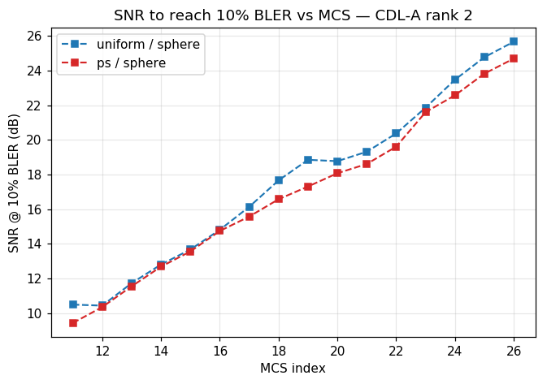

### CDL-A rank 3

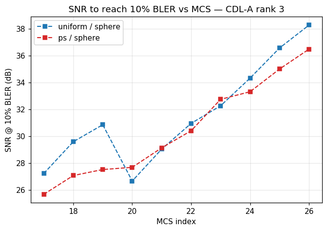

### CDL-A rank 4

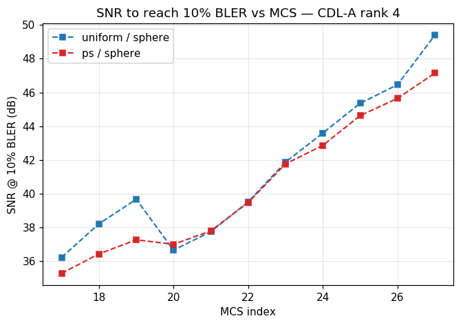

### CDL-C rank 3

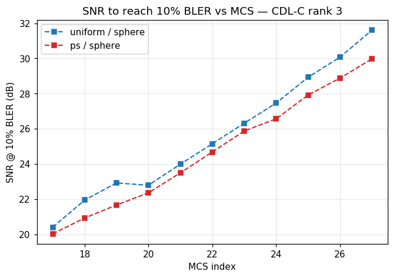

### CDL-C rank 4

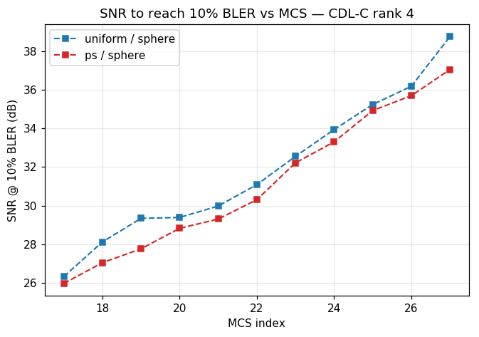

### CDL-B rank 4

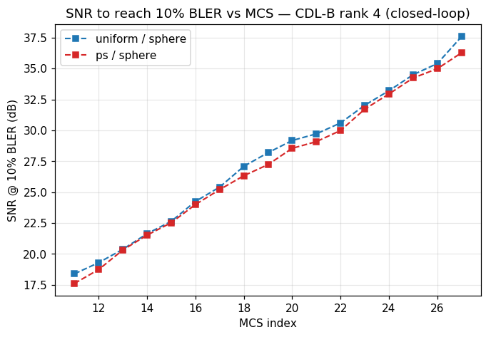

### TDL-A rank 4 open-loop (11 Hz Doppler, PS mcs_table1)

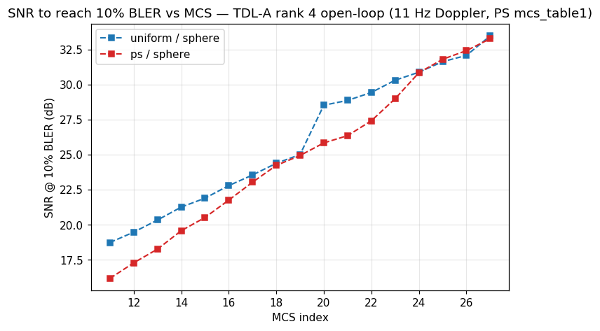

## 3. Max-over-(MCS & rank) throughput vs SNR (seed-averaged)

For each seed and SNR, throughput is maximized over all available MCS and all ranks of the channel, then averaged over seeds. Models a system that adapts both MCS and rank. For CDL-A, the results are based on radaption over ranks 2,3,4; For CDL-B and TDL-A (open-loop), it has a single rank (i.e., rank 4). For CDL-C, adaptation is over rank 3 and rank 4.

### CDL-A (ranks 2, 3, 4)

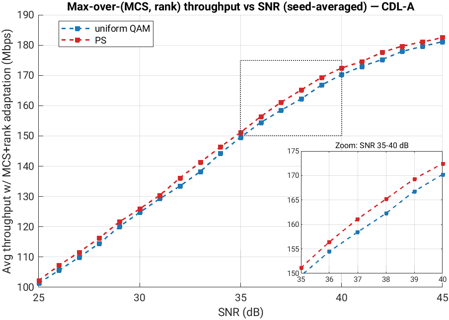

### CDL-B (ranks 4)

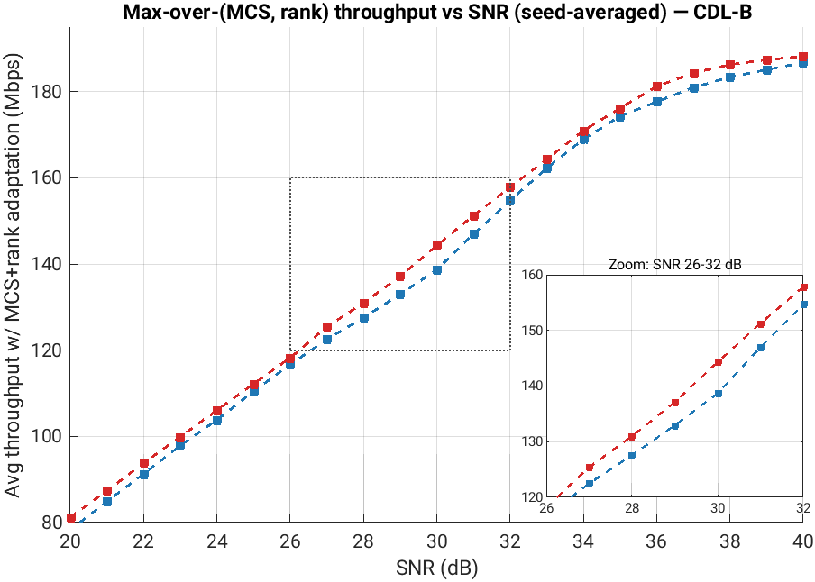

### CDL-C (ranks 3, 4)

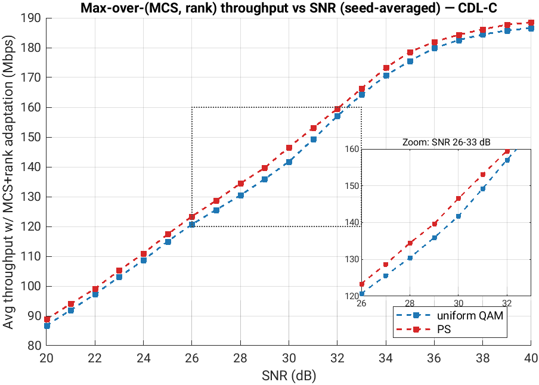

### TDL-A (open-loop, ranks 4)

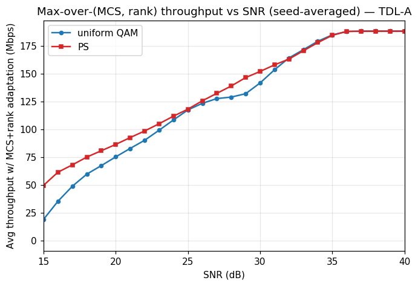
